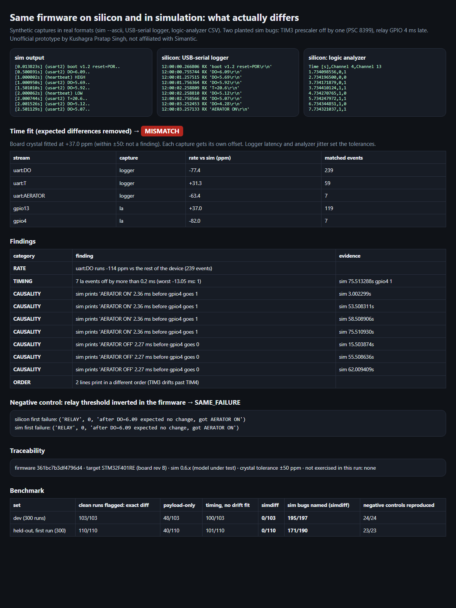

# Silicon vs simulation diff: "investigate every mismatch", as a tool

> Unofficial prototype by Kushagra Pratap Singh. Not affiliated with Simantic. Synthetic captures in real formats; nothing here ran on Simantic's engine or on a board.

## The problem

Simantic's [validation standard](https://simantic.com/validation) says:

> Run the same firmware on real silicon and in simulation. Compare the results and investigate every mismatch. … Check behavior, timing, and repeatability … Verify that deliberately broken firmware fails for the right reason … Make results traceable to the firmware, hardware target, and simulator version tested.

The examples repo shows what that looks like by hand today. Runs against a flight-controller build are compared by counts and values per example ("same count as the reference peer", [examples](https://github.com/simantic-dev/examples)).

Comparing a board with a simulator by hand or by diff runs into the same traps every time:
- The board's crystal drifts by tens of ppm, while the sim clock is ideal. Over 2 minutes that's several ms, far beyond a logic analyzer's microsecond precision.
- A USB-serial logger stamps lines with host time, adding milliseconds of latency, and splits lines into chunks.
- Every capture tool starts its clock at a different moment.
- The bugs that matter are small. A TIM3 prescaler off by one at PSC 8399 is **119 ppm**, only about twice what a crystal is allowed to drift.

## What I built

`simdiff` takes their `sim --ascii` output, a USB-serial logger file and a logic-analyzer CSV (GPIO edges), and:

1. **Parses** all three. Logger chunks are merged into lines, timed by the chunk that completed them. Scripted observers (`(relay) HIGH`) are mapped to pins.
2. **Aligns** them:
   - UART lines by sequence alignment.
   - GPIO edges by time only, after taking each periodic pin's rate from its own edge intervals, so a 1% timer error still matches.
   - Runs of identical lines ("DO=3.00" × 20) are re-paired by time.
3. **Fits time** with Theil–Sen per stream, plus one offset per capture source. The device's rate is voted on by periodic timer streams only; event-driven lines just follow their timer. The analyzer decides when it agrees, since it is ~1000× more precise than the logger.
4. **Names what's left:**

| category | meaning |
|---|---|
| CLOCK | whole device off beyond the crystal tolerance (PLL / clock tree) |
| RATE | one timer-driven stream at a different rate than the rest (prescaler, auto-reload); the tolerance grows when a stream is short or sparse |
| VALUE | same slot, different payload (reset flags, FP formatting, a pin at the opposite level) |
| MISSING / EXTRA | silicon shows it and the sim never does, or the reverse. Unmatched events at the capture edges don't count. A lost toggle is one finding plus "later edges inverted" |
| ORDER | same events, different order (IRQ priority) |
| TIMING | matched events further apart than the capture can explain (15 ms logger, 0.2 ms analyzer) |
| CAUSALITY | a declared cause → effect broken in the sim: "AERATOR ON" printed before the relay pin moves |

5. **Negative controls:** the firmware's own spec is checked on each trace using only intervals within a stream, so any capture clock works:
   - boot banner
   - heartbeat period
   - relay hysteresis replayed from the printed DO values
   - temperature reads
   - liveness

   A deliberately broken firmware must fail **on both**, at the **same first check**.
6. **Report:** verdict, per-stream rate table, evidence lines, firmware hash / target / sim version, and what this run never exercised.

The behaviour model is the aerator controller from Simantic's docs: Modbus DO poll, relay on GPIO4 with hysteresis, heartbeat, I2C temperature with NACK/retry, boot banner with reset flags. It runs on synthetic silicon (crystal drift, ISR jitter, serialised UART, USB latency, split lines, analyzer jitter) and on a synthetic sim with planted bugs:
- prescaler off-by-one, wrong PLL, wrong reset flags
- IRQ priority swapped, I2C NACK not modelled
- slow GPIO, a dropped interrupt every N, FP rounding



## Results

Truth comes from the generator: a planted bug only counts if it changes what this firmware does in a noiseless sim, with versus without the bug. The **held-out bank** (other firmware timings, a noisier logger, 30% split lines, a tighter 30 ppm crystal, subtler bugs) was **committed to git before its first run**.

| set | clean runs flagged: exact diff | payload-only | timing, no drift fit | **simdiff** | sim bugs named by simdiff | negative controls reproduced |
|---|---|---|---|---|---|---|
| dev (300 runs) | 103/103 | 48/103 | 100/103 | **0/103** | 195/197 | 24/24 |
| **held-out, first run (300)** | 110/110 | 40/110 | 101/110 | **0/110** | **171/190** | **23/23** |

The baselines "catch" bugs only because they flag nearly everything, clean runs included. simdiff flags no clean run and names the bug's category.

**What the held-out run missed (first run, reported as-is, nothing tuned after):**
- **All 19 misses are the prescaler bug**, mostly PSC 47999 (**21 ppm**). I put it in the held-out bank on purpose because it is below the 30 ppm crystal tolerance: one capture of one board cannot tell it from crystal drift. simdiff still flagged 17 of those runs as MISMATCH (TIMING/ORDER), just not as RATE. Telling those apart needs several boards, or a reference clock on the analyzer.
- Two runs where the firmware hard-faulted early got CLOCK instead of RATE: too few events to say which timer was off.
- 16 bug runs also carry a side-effect category (e.g. a prescaler bug also changing which DO value lands next to a relay switch).
- Dev development notes: my first capture model let USB latency reorder lines (a real serial port can't) and let two UART lines transmit at once. Both were generator fixes made before the held-out set existed.

**Limits:**
- No real `sim` run (MCU models are account-gated) and no real board. The parsers take the documented `sim` format and a Saleae-style CSV export.
- The host clock and the analyzer clock are assumed accurate to a few ppm.
- Causality pairs and the firmware spec are written per firmware (they're short).

## Run it

```
python demo.py                # one run with two planted sim bugs + a negative control -> out/report.html
python evaluate.py heldout    # or: dev
python -m pytest -q           # 7 tests
```

Python 3.10+, standard library only (pytest for tests). On real data: `compare(sim_lines, logger_lines, la_csv_text, crystal_ppm=...)`.
